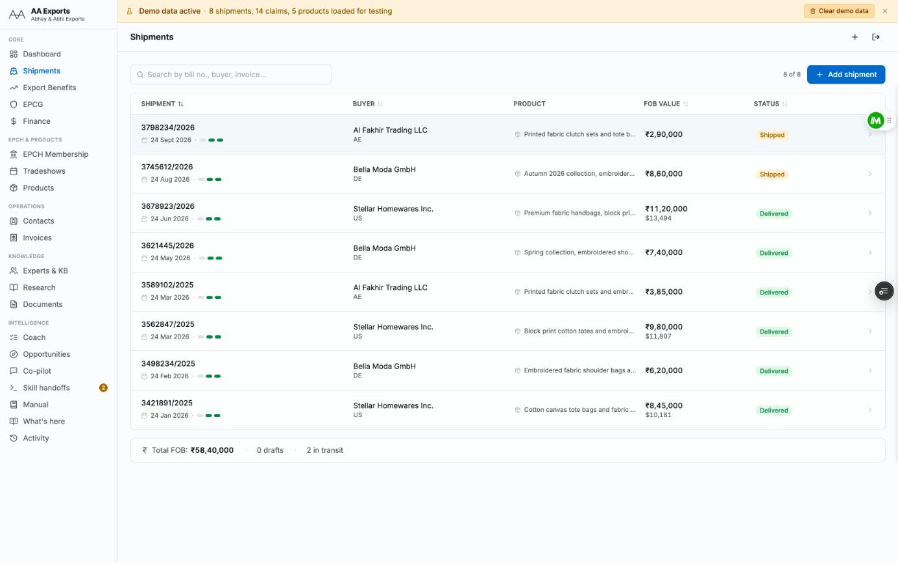
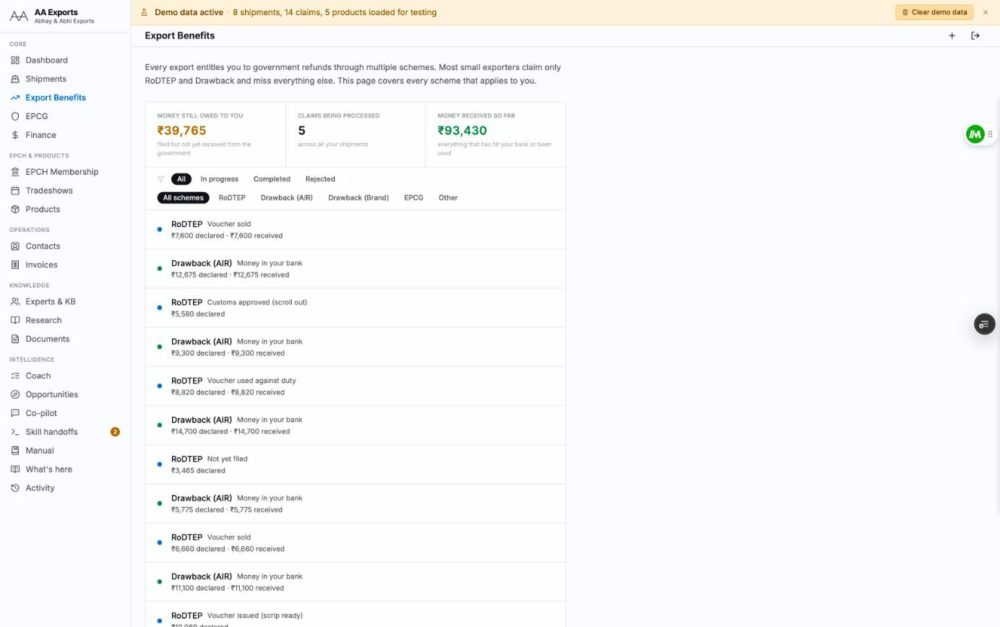
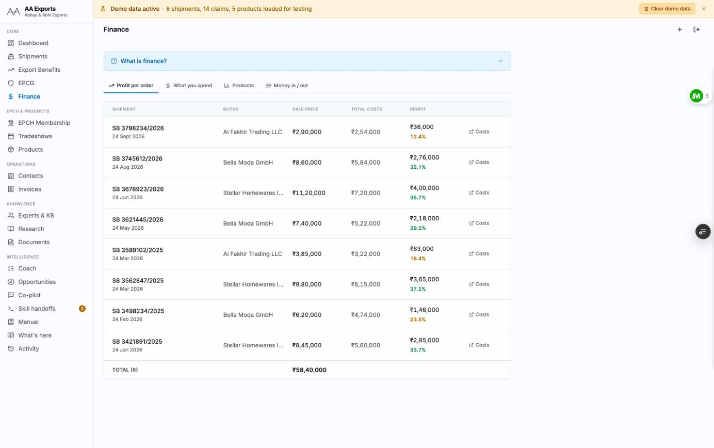
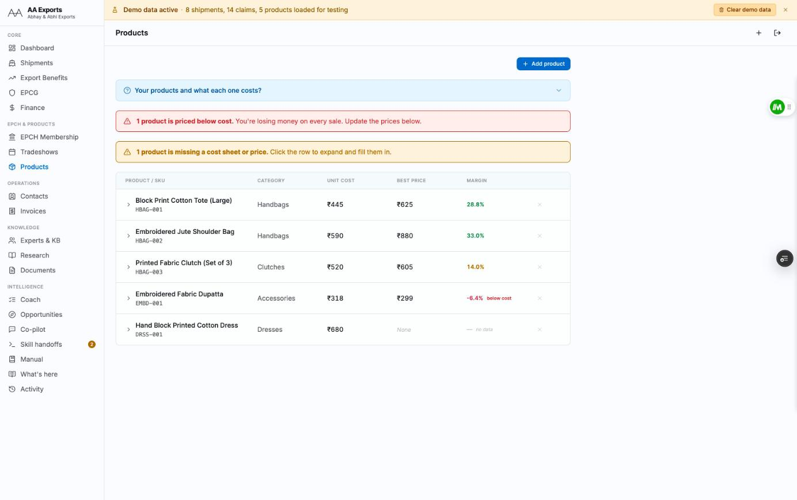
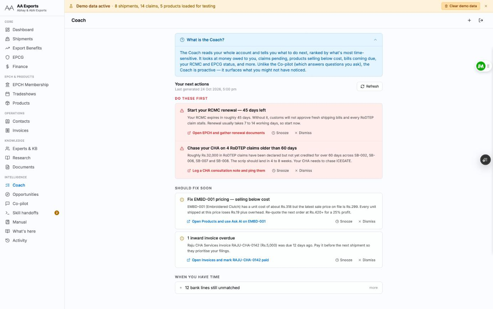
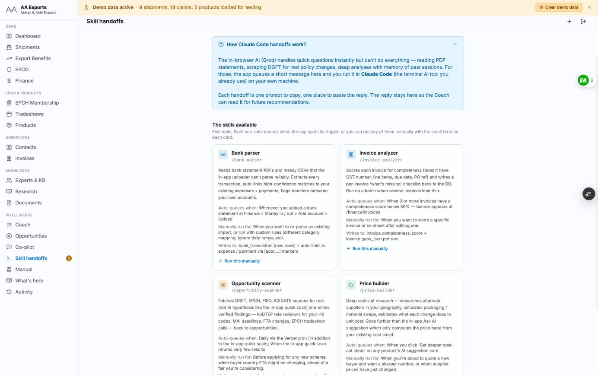
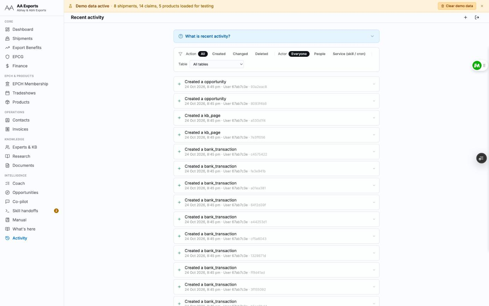
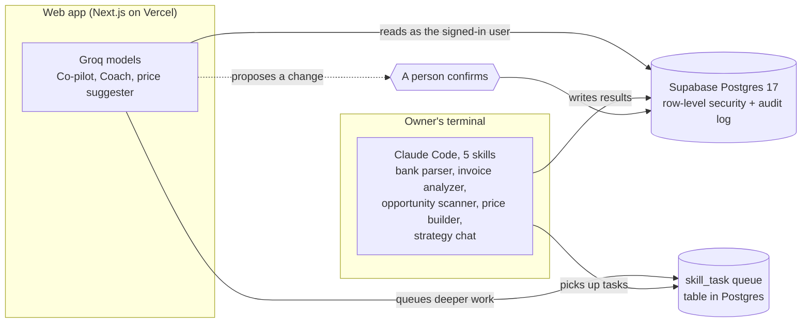

# AA Exports operations platform

A web app I built for my family's export business, A&A Exports, a manufacturer of fashion accessories. Shipments, government refund claims, invoices and bank statements used to live in spreadsheets, WhatsApp threads and emails from the customs agent. This puts them in one database, adds AI agents that read it and suggest what to do next, and makes sure those agents can't change anything without a person saying yes.

I was the only engineer: 38 features and 28 SQL migrations since June 2026. The source stays private because it holds a real business's data model and deployment settings. This repo has the screenshots, the architecture and the reasoning. I'm glad to walk through the code on a call.

Built with Next.js 15, TypeScript, Supabase (Postgres 17), Tailwind v4 and shadcn/ui, deployed on Vercel.

## What it looks like

Every screenshot below uses the app's built-in demo data.

| | |
|---|---|
|  |  |
| **Shipments.** Each export order with its buyer, FOB value, status and a readiness bar. | **Export benefits.** RoDTEP, Duty Drawback and EPCG claims, with money still owed and money received. |
|  |  |
| **Finance.** Profit per order, built from the costs logged against each shipment. | **Products.** Anything priced below cost, or missing a cost sheet, gets flagged at the top. |
|  |  |
| **Coach.** A ranked list of what to do next. Each card links to the page where you fix it. | **Skill handoffs.** The app queues work for Claude Code on the owner's machine and takes the reply back. |
|  | |
| **Activity.** Every insert, update and delete, whether a person or an agent made it. | |

## Why it exists

The two owners aren't technical, and the money they were missing was easy to miss. An export entitles the business to several government refunds (RoDTEP, Duty Drawback, EPCG), each with its own filing window and credit timeline. Certificates like the RCMC expire, and a lapsed one stalls the next shipment at customs. Cost sheets go stale, so some products end up sold below cost without anyone noticing. The app tracks all of that and puts the most urgent items on one screen.

It also tries to keep data entry short. Save one record and the connected ones fill in: a shipment with an invoice number creates the outward invoice, a shipment cost creates the expense, a credited claim creates the incoming payment. Every record created this way is stamped `[auto:<source>:<id>]` in its notes, so re-runs don't duplicate and an undo can walk back through everything one action created.

## How the AI part works

**Two runtimes, one queue.** Quick questions go to Groq models inside the app. Work that needs files, scraping or memory goes to Claude Code on the owner's machine: parsing a bank statement PDF, pulling policy changes from government sites, researching cheaper suppliers. The app puts a prompt in a `skill_task` table, the owner runs it in a terminal, and the reply lands back in the database where the Coach reads it on its next run.

**No silent writes.** When an agent in the app wants to change data, it shows a confirmation card and waits. Nothing is saved until a person clicks Confirm. The terminal skills only run when the owner starts one, and what they write is stamped and logged like everything else.

**In-app agents see what the user sees.** Their tool calls run with the signed-in user's session, so row-level security applies to them the same way it applies to a person. Inside the web app, the service-role key is used only by the cron job and the backup workflow.

**Everything can be traced.** Every write, human or AI, goes through an audit trigger on 25 core tables that records who did it and what changed. Deletes from the interface are soft, so a mistake can be walked back.

**Guardrails.** There are four roles (owner, accountant, customs agent, read-only), enforced in the database. Signup is limited to an email allowlist. Every AI endpoint has a per-user rate limit.

## Testing and operations

- 25 Playwright end-to-end tests run on every pull request against the Vercel preview. One of them walks every route in the feature catalog and fails if any page errors, which catches the "I changed one page and broke another" bug.
- 16 Vitest cases cover the pure logic: the auto-record chain and bank-statement reconciliation.
- Three GitHub Actions workflows: typecheck and smoke test on each PR, the end-to-end suite, and a daily `pg_dump` backup to a private bucket. The backup job rejects any dump under 1 KB, so a silent failure can't leave an empty backup behind. Backups roll over after 30 days.
- A Vercel cron refreshes the Coach every day. Sentry covers errors, tracing and session replay.
- The docs a second engineer would need are in the private repo: a README, an architecture write-up, an API route list, and a handoff note.

## Stack

| Layer | What I used |
|---|---|
| App | Next.js 15 (App Router), React 19, TypeScript |
| UI | Tailwind v4, shadcn/ui |
| Data | Supabase: Postgres 17, auth, storage, realtime |
| AI in the app | Groq via the AI SDK (Llama 3.3 70B, gpt-oss-120b, gpt-oss-20b) |
| AI in the terminal | Claude Code with five custom skills |
| Tests | Playwright, Vitest |
| CI and ops | GitHub Actions, Vercel (hosting and cron), Sentry |

## Contact

Abhay Parashar · [abhayparashar.com](https://abhayparashar.com) · [LinkedIn](https://www.linkedin.com/in/parashar-abhay/) · abhayparasharr@gmail.com
